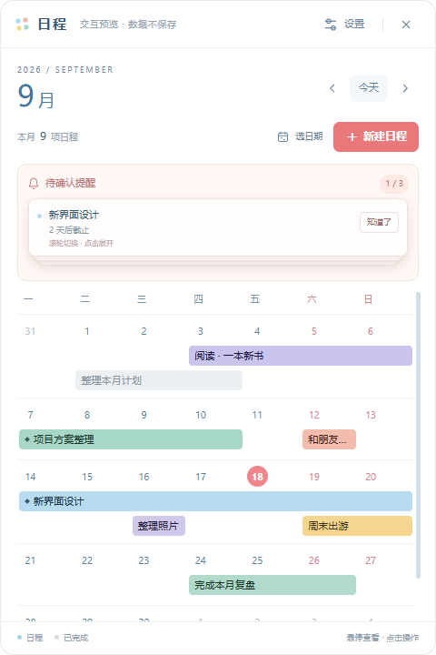

# 小鱼日程表

一款轻量的 Windows 桌面日程工具，采用整月日历和连续横条展示日程跨度。目前处于 Demo 与实地体验调整阶段。



## 当前功能

- 桌面挂件：嵌入桌面、显示整月日程、悬停查看详情、自由摆放与钉住
- 主窗口：新建、编辑、删除、完成、置顶和按月份浏览日程
- 连续日程条：跨天、跨周显示，多条日程自动增加周行高度
- 提醒卡片：未确认提醒堆叠显示，可滚轮切换、展开和逐条确认
- 窗口吸附：支持顶部、左侧和右侧吸附，离开后自动收起
- 外观设置：可调整桌面挂件的颜色、透明度、字体和日程条尺寸
- 本地存储：日程数据只保存在本机，不上传到网络

## 文档

- [产品需求文档](需求_v1.3.md)
- [现有功能目录树](功能目录树.md)
- [运行与开发说明](app/README.md)
- [主界面交互预览](设计/主界面预览.html)

## 运行

系统要求：Windows 10 / 11（64 位），并已安装 Node.js。

首次运行：

```powershell
cd app
npm install
npm start
```

安装依赖后，也可以直接双击根目录的 `启动日程挂件.cmd`。

程序数据保存在 `app/.data/`，该目录已加入 Git 忽略列表，不会提交到仓库。

## 项目结构

```text
app/main/             Electron 主进程、窗口、托盘和数据存储
app/preload/          页面与主进程之间的安全接口
app/renderer/shared/  两种窗口共用的日历、日期和颜色逻辑
app/renderer/w1/      桌面挂件
app/renderer/w2/      主窗口、填写弹窗和设置页
app/scripts/          主界面交互预览工具
设计/                 界面预览文件与截图
```

## 自测

```powershell
cd app
npm run selftest
```
