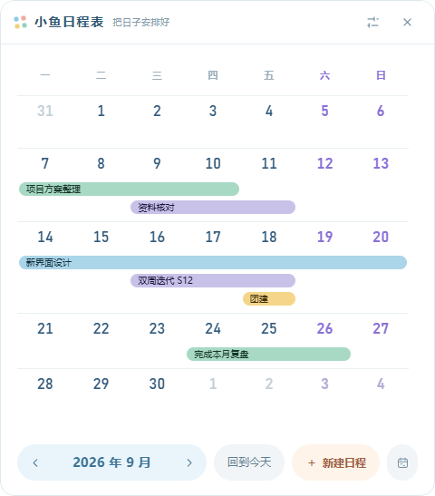

# 小鱼日程表

一款轻量的 Windows 桌面日程工具，采用整月日历和连续横条展示日程跨度。目前处于 Demo 与实地体验调整阶段。

截至 2026-10-20，主界面保留纯白背景、明亮蓝紫色周末、17px 日期字号，以及随窗口宽度和日程数量变化的周行留白。新增单击一天 / 拖选日期后直接新建；填写弹窗改为紧凑布局，颜色与提醒按需展开，主界面统一使用 14.52px 白色细描边指针。详情展开和收起仍带动窗口调整高度。具体完成项、验证结果和下一步见 [项目进度](项目进度.md)。

桌面显示参考 Rainlendar 的行为与 Rainmeter 的公开实现：隐藏网页负责排版，独立原生透明窗口负责显示；桌面恢复与鼠标悬停分开处理。**100% 和 125% 缩放下的隐藏检查通过，用户手动确认日历可见、图标清晰位于上方，鼠标经过不再闪烁。** 点击系统“显示桌面”后是否保留尚未单独确认；这一版尚未接入背景磨砂，暂用透明底板。此前失败的两次短测与后续成功反馈分别记录，详情和参考来源见 [项目进度](项目进度.md)。

[独立 HTML 模拟](设计/桌面钉住效果模拟.html) 保留为外观对照，其中的换壁纸、模拟工作窗口和示例日程切换是预览工具。双击根目录的 [打开桌面效果预览.html](打开桌面效果预览.html) 即可离线查看，无需启动服务。聊天中的 `127.0.0.1:13936` 是临时预览地址，服务停止后需要重新启动。



## 当前功能

- 桌面挂件：显示整月日程、悬停查看详情、自由摆放与钉住；用户已确认可见、图标在上方且不闪，显示桌面待确认、磨砂待接入
- 主窗口：单击 / 拖选日期后新建，或点击下方按钮新建；支持编辑、删除、完成、置顶和按月份浏览
- 填写弹窗：标题、并排日期与两行备注默认可见，颜色和提醒按需展开，底部保存与取消始终可见
- 连续日程条：跨天、跨周显示，多条日程自动增加周行高度
- 提醒卡片：未确认提醒堆叠显示，可滚轮切换、展开和逐条确认
- 窗口吸附：支持顶部、左侧和右侧吸附，离开后自动收起
- 外观设置：玻璃不透明度、宽度、日期字号、磨砂效果（关闭／轻磨砂／柔雾）、玻璃底色和文字颜色，另保留日程条字号与高度；实时预览、保存与恢复默认
- 本地存储：日程数据只保存在本机，不上传到网络

## 文档

- [项目进度与下一步](项目进度.md)
- [产品需求文档](需求_v1.3.md)
- [现有功能目录树](功能目录树.md)
- [运行与开发说明](app/README.md)
- [软件当前主界面的交互预览](设计/主界面预览.html)
- [已采用的日历布局与配色方案](设计/便当盒主界面提案.html)
- [桌面钉住效果的 HTML 对照](设计/桌面钉住效果模拟.html)

## 运行

系统要求：Windows 10 / 11（64 位），并已安装 Node.js。

首次运行：

```powershell
cd app
npm install
npm start
```

安装依赖后，也可以直接双击根目录的 `启动日程挂件.cmd`。

程序数据保存在 `app/.data/`，该目录已加入 Git 忽略列表，不会提交到仓库。

## 项目结构

```text
app/main/             Electron 主进程、窗口、托盘和数据存储
app/preload/          页面与主进程之间的安全接口
app/renderer/shared/  两种窗口共用的日历、日期和颜色逻辑
app/renderer/w1/      桌面挂件
app/renderer/w2/      主窗口、填写弹窗和设置页
app/scripts/          主界面交互预览工具
设计/                 界面预览文件与截图
```

## 自测

```powershell
cd app
npm run selftest
```

`npm run selftest:desktop-headless` 只使用隐藏的自有窗口检查绘制、定位和恢复，不切换桌面。

`npm run selftest:calendar-selection` 和 `npm run selftest:task-dialog` 分别检查两种新建入口与紧凑弹窗。两者都使用隐藏页面与内存示例，不控制系统鼠标、不读写真实日程；10 月 20 日的 14 项和 8 项检查已通过。完整自测和可见桌面短测会显示窗口，先确认不影响正在使用电脑的人。

获准可见测试后，运行 `npm run selftest:desktop`：先显示 4 秒独立挂件，再钉住 16 秒，结束后自动退出；最迟 25 秒退出。用户可在钉住阶段点击系统“显示桌面”，观察图标层级与闪烁。使用独立测试数据，不测试磨砂；程序记录与实际观察分别报告。
