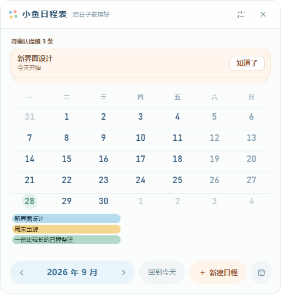

# 小鱼日程表 · 项目进度

更新日期：2026-09-29。

## 当前停在哪里

软件已经能运行，主界面完成了一轮重做，圆角和窗口动态高度的问题也已修复。现在正在讨论日历的疏密和留白，**最新的字号、周行高度和日程叠放示例只改在 HTML 里，还没有应用到软件，也没有得到最终确认。**

接下来先看这一版 HTML 的实际效果，确定后再迁移。不要把“已做出预览”记成“已应用到软件”。

| 内容 | 当前状态 | 文件入口 |
| --- | --- | --- |
| 实际软件 | 已应用竖版主界面、提醒卡片、底部操作和动态详情；保留原有日程功能 | `app/` |
| 软件当前界面的浏览器预览 | 由实际软件页面生成，可以体验示例数据的交互 | [主界面预览.html](设计/主界面预览.html) |
| 最新日历布局方案 | 正在调整，等待星尘确认；目前默认展示两三条日程叠放 | [便当盒主界面提案.html](设计/便当盒主界面提案.html) |
| 需求与功能清单 | 保留作功能依据；当前实施状态以本文为准 | [需求_v1.3.md](需求_v1.3.md)、[功能目录树.md](功能目录树.md) |

## 已经应用到软件

- 主窗口改为竖版圆角卡片。提醒在日历上方，月份切换、回到今天和新建入口在日历下方，日程详情位于最下方。
- 提醒使用堆叠卡片，可以点击展开、收起，用滚轮切换顶层卡片，逐条点击“知道了”。
- 保留新建、编辑、删除前确认、完成、置顶、月份浏览、拖选日期等已有功能。
- 日程条悬停、选中时使用较轻的颜色和位移反馈，去掉原来突兀的边框。
- 修复主窗口左上角等圆角的裁切：根页面透明，面板统一裁切背景和内容。
- 修复真实窗口的高度联动：悬停日程时向下展开详情，窗口底边随动画延伸；移开后缩回。点击日程后详情保持显示，点击空白处收起。
- 正常展开详情时，日历和窗口顶边保持原位。到达屏幕工作区底部时才限制窗口高度，让内容滚动；长备注保留完整文字。
- 提醒展开也会增加窗口高度。新建弹窗和设置页会留出操作空间；上、左、右贴边的收起与滑出仍保留。

软件当前外观，使用 2026-09-28 的独立测试数据：

## 最新 HTML 方案，尚未应用

星尘认为软件里的日历太紧凑；第一版加大留白后，又反馈日期数字稍大、空白周偏高，需要加入两个以上日程的例子一起看。

2026-09-29 的最新调整为：

- 日期字号由试验版的 18px 收到 17px。软件中的日期字号目前仍是 16px。
- 空白周保留适量基础高度，并随窗口宽度变化；480px 宽度的预览中约为 58px，窄版下限为 56px。
- 有日程的周按实际条数增加高度。当前示例中，1 条、2 条、3 条分别约为 61px、81px、101px。
- 默认在同一张月历里摆放空白周、2 条叠放、3 条叠放、1 条日程、空白周，方便直接比较。
- 页面外部提供“1 条日程 / 2–3 条叠放 / 多条日程 / 无日程”切换，以及 480px、400px 宽度切换。这些是预览工具，不属于软件界面。
- 继续保留日程详情在底部展开的效果。日历有基础比例，日程多时仍可增高，整个窗口不设固定高度。

这份 HTML 用于讨论布局，并非完整的软件功能入口；其中部分操作按钮仍是示意。不要用它替换实际软件页面，也不要用生成脚本覆盖它。

## 后续继续遵守的交互约定

- 整体方向是干净、清爽、稍带活泼的扁平化小卡片；减少一层套一层的外壳。
- 主界面顶部只放提醒；月份和新建等操作放在日历下面。
- 悬停显示日程详情，点选后保留详情并显示操作。详情展开要有缓动，同时带动真实窗口底边。
- 弹窗存在时阻止主窗口自动收起。主动关闭或收起时，可以放弃未保存的输入，不做草稿保留。
- 删除前确认，不做删除撤销。
- 已完成日程在桌面挂件中隐藏，在主窗口中置底并灰显。
- 跨天日程保持连续，不按每天的上限把同一条日程任意截断；当前先按内容增高，暂不设硬性条数上限。
- 阿砚后续不参与开发。`交流/` 保留历史文件，不再阅读、续写或作为交接入口；后续进度统一更新本文。

## 已做的验证

### 实际软件：2026-09-28

运行 `npm run selftest`，使用独立的 `app/.data-selftest/`，结果通过。测试代码保存在 `app/main/selftest.js` 和 `app/main/w2-layout-selftest.js`。

- 示例数据下，悬停前后真实窗口高度为 **501 → 607 → 501px**，展开和收起都记录到中间帧；窗口顶边和日历位置不变。这是该组数据的实测值，不是固定尺寸。
- 四个圆角外的像素透明。
- 点选保留详情、点击空白收起、快速切换日程、提醒展开与收起通过检查。
- 靠近屏幕底部时限制在工作区内，底部操作可见，长备注可以滚动。
- 上、左、右贴边后，收起仍只露出 3px，滑出位置正确。
- 原有自测还检查了新建保存、空标题校验、设置页、桌面挂件嵌入及解锁。

原始截图和结果在本机 `app/.data-selftest/shots/`，不随运行缓存一起上传。本文记录结果，并单独保存了上方的示例截图。

### HTML 方案：2026-09-29

最新叠放方案已在浏览器查看。默认 480px 宽度下，五周实测高度依次为 **58 / 81 / 101 / 61 / 58px**；日期字号为 17px，日程条没有超出所在周的边界。这些尺寸仍待星尘体验后决定。

## 下一步

1. 继续查看最新 HTML，确认日期字号、空白周高度、日程之间的间距，以及两三条叠放的密度。
2. 确认后，再把选定的规则迁移到实际软件。主要修改位置是 `app/renderer/w2/w2.css`，需要调整日程条排列时再看共享日历代码，避免意外改变桌面挂件。
3. 迁移后检查少量、多条、无日程和不同宽度下的效果，继续验证详情展开时的真实窗口高度。
4. 在 `app` 目录运行 `node scripts/preview-main.js`，更新由软件生成的 `设计/主界面预览.html`，再更新本文。

目前没有执行以上第二步。最新 HTML 的最终样式确认仍待完成。

## 本次 GitHub 保存范围

保存全部项目源码、启动脚本、依赖清单和锁文件、需求文档、功能清单、README、本文、设计 HTML、项目截图，以及已经存在的其他项目文件和修改。

沿用 `.gitignore`，不上传 `app/node_modules/`、`.cache/`、`app/.data/`、`app/.data-selftest/`：它们分别是可重新安装的依赖、缓存、本机日程数据和自测运行数据。所需的示例截图已单独放进 `设计/`。
