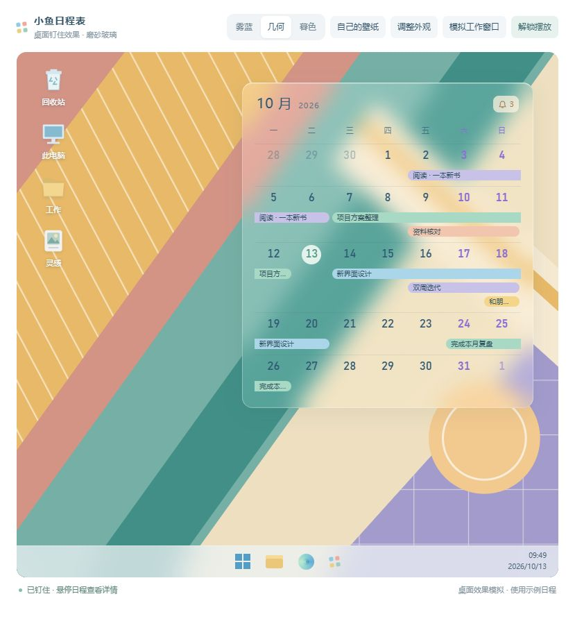

# 小鱼日程表 · 项目进度

更新日期：2026-10-13。

## 当前停在哪里

**主界面的方案已应用到程序；桌面挂件正在用独立 HTML 调整透明磨砂玻璃效果。** 主界面采用纯白背景、明亮蓝紫色周末、17px 日期，以及较舒展的日历留白，迁移已通过自测。桌面模拟已改成磨砂玻璃底板，接下来继续在 HTML 中逐步调整，确认后再应用到实际桌面挂件。

悬停详情和提醒展开仍会带动真实窗口增高，整个主窗口没有固定高度。设计 HTML 仅保留为方案参考，软件功能仍由 `app/` 中的代码提供。

| 内容 | 当前状态 | 文件入口 |
| --- | --- | --- |
| 实际软件 | 已迁移最新留白、字号和配色，保留提醒、底部操作、动态详情和日程功能 | `app/` |
| 桌面挂件效果模拟 | 已调整为透明磨砂玻璃，可以拖动摆放、钉住、悬停查看详情和调整外观；尚未应用到软件 | [桌面钉住效果模拟.html](设计/桌面钉住效果模拟.html) |
| 软件当前界面的浏览器预览 | 由实际软件页面生成，可以体验示例数据的交互 | [主界面预览.html](设计/主界面预览.html) |
| 日历布局方案 | 已采用；默认展示空白周、两三条叠放和单条日程，作为视觉参考 | [便当盒主界面提案.html](设计/便当盒主界面提案.html) |
| 需求与功能清单 | 保留作功能依据；当前实施状态以本文为准 | [需求_v1.3.md](需求_v1.3.md)、[功能目录树.md](功能目录树.md) |

## 已经应用到软件

- 主窗口改为竖版圆角卡片。提醒在日历上方，月份切换、回到今天和新建入口在日历下方，日程详情位于最下方。
- 提醒使用堆叠卡片，可以点击展开、收起，用滚轮切换顶层卡片，逐条点击“知道了”。
- 保留新建、编辑、删除前确认、完成、置顶、月份浏览、拖选日期等已有功能。
- 日程条悬停、选中时使用较轻的颜色和位移反馈，去掉原来突兀的边框。
- 修复主窗口左上角等圆角的裁切：根页面透明，面板统一裁切背景和内容。
- 修复真实窗口的高度联动：悬停日程时向下展开详情，窗口底边随动画延伸；移开后缩回。点击日程后详情保持显示，点击空白处收起。
- 正常展开详情时，日历和窗口顶边保持原位。到达屏幕工作区底部时才限制窗口高度，让内容滚动；长备注保留完整文字。
- 提醒展开也会增加窗口高度。新建弹窗和设置页会留出操作空间；上、左、右贴边的收起与滑出仍保留。
- 2026-10-10 应用纯白主界面背景；周末表头和日期采用明亮蓝紫色 `#8a70d6`，非本月周末为浅一档的 `#b7acd7`。今天继续使用薄荷绿圆底。
- 应用 17px 日期字号、28px 日期行和今天圆底。空白周随宽度变化，最小 56px；有日程的周按条数自然增高。
- 日程条仍高 15px，条间距为 5px；增大提醒与日历之间的留白、日历上下留白和底部操作间距。滚动条出现时不会改变日历宽度。
- 这些布局参数只由主窗口使用；桌面挂件仍保留原来的尺寸规则。预览页面外部的密度和宽度切换工具没有放入软件。

软件当前外观，使用独立的 2026 年 9 月示例数据，截图于 2026-10-10：

## 正在调整的桌面挂件 HTML

2026-10-10，星尘要求先用 HTML 模拟钉在桌面的效果，再慢慢调整。文件为 [桌面钉住效果模拟.html](设计/桌面钉住效果模拟.html)，可以直接双击打开，无需安装依赖。

2026-10-12 修复预览入口：原来的 `127.0.0.1:13936` 无法访问，是本地预览服务已停止，检查时该端口没有进程监听，HTML 文件仍在。已重新启动服务，并新增根目录的 [打开桌面效果预览.html](打开桌面效果预览.html)，双击即可直接打开本地文件，无需服务。临时网址不保证跨会话持续运行；之后离线查看可使用这个入口。这次入口修复没有修改桌面模拟的布局或实际程序。

同日，按星尘要求将桌面模拟改为透明磨砂玻璃：默认白色底板不透明度从 62% 降至 24%，背景模糊从 12px 增至 24px，并添加轻微的透光渐变、边缘高光和柔和阴影。模糊仅作用于卡片背后的壁纸，日期与日程条保持清晰；“调整外观”内可以设置玻璃不透明度、玻璃底色和 0–40px 磨砂强度。已在浏览器查看效果，检查默认样式和磨砂滑块即时生效。实际程序尚未应用这次材质调整。

2026-10-13，星尘反馈原背景下磨砂效果不明显。本次把默认预览背景换成带斜线、网格和交错色块的彩色几何壁纸，原“浅色”选项改为“几何”；“雾蓝”和“暮色”仍可切换。背景图形内嵌在 HTML 中，离线打开也能显示。已在浏览器查看玻璃内外的清晰度差异，并验证背景切换；玻璃参数仍为上一版的 24% 不透明度、24px 模糊。

同日，按星尘“磨砂弱一些、底色透明一些”的反馈，把默认模糊从 24px 降为 14px，白色底板不透明度从 24% 降为 14%，外观调节滑块同步更新。已在浏览器确认实际样式并查看效果，壁纸颜色和轮廓透出更多。本次仅调整 HTML 预览，尚未应用到实际桌面挂件。

- 放在完整的桌面场景中查看：壁纸、桌面图标、任务栏，以及可以遮住挂件的示例工作窗口。
- 第一版以半透明白色底板、蓝紫色周末和连续日程条为起点；顶部显示当月月份与角落提醒标志。
- 点击“解锁摆放”后拖动上方提示条，再点击“钉住”；钉住后保留悬停详情，不提供日程编辑入口。
- 日程详情在日历下方缓动展开，卡片自然增高，顶边保持原位；移开后收回。内容多时模拟桌面也会增高，避免裁掉下方日程。
- 预览工具放在桌面场景外：三种壁纸、选择自己的壁纸，以及底板颜色、不透明度、模糊、宽度、日期字号、文字和周末颜色。
- 可以切换少量、适中、密集、无日程的示例。日期随打开时的月份生成，示例日程只存在页面内存中。
- 实际软件的桌面挂件 `app/renderer/w1/` 本轮没有迁移；这份 HTML 只模拟外观和交互，不是真实的 Windows 桌面嵌入，也不读取、保存实际日程。

当前轻磨砂玻璃效果（几何背景，14% 不透明度、14px 模糊）：

10 月 10 日的第一版截图保留在 `设计/桌面钉住效果-2026-10-10.png`；10 月 12 日的雾蓝背景磨砂效果保留在 `设计/桌面磨砂玻璃效果-2026-10-12.png`；10 月 13 日调整前的几何背景效果保留在 `设计/桌面磨砂玻璃-几何背景-2026-10-13.png`，用于对比。

## 已采用的 HTML 方案

星尘认为软件里的日历太紧凑；第一版加大留白后，又反馈日期数字稍大、空白周偏高，需要加入两个以上日程的例子一起看。

2026-09-29 确定的布局调整，已于 2026-10-10 迁移：

- 日期字号由试验版的 18px 收到 17px，软件现已一致。
- 空白周保留适量基础高度，并随窗口宽度变化；480px 宽度的预览中约为 58px，窄版下限为 56px。
- 有日程的周按实际条数增加高度。当前示例中，1 条、2 条、3 条分别约为 61px、81px、101px。
- 默认在同一张月历里摆放空白周、2 条叠放、3 条叠放、1 条日程、空白周，方便直接比较。
- 页面外部提供“1 条日程 / 2–3 条叠放 / 多条日程 / 无日程”切换，以及 480px、400px 宽度切换。这些是预览工具，不属于软件界面。
- 继续保留日程详情在底部展开的效果。日历有基础比例，日程多时仍可增高，整个窗口不设固定高度。

这份 HTML 用于讨论布局，并非完整的软件功能入口；其中部分操作按钮仍是示意。不要用它替换实际软件页面，也不要用生成脚本覆盖它。

2026-10-10 试过珊瑚红、湖蓝、青绿和蓝紫后，星尘选择先保留明亮蓝紫色周末与纯白背景。当前配色以设计 HTML 和软件代码为准；下面的早期截图只记录留白方案。

## 后续继续遵守的交互约定

- 整体方向是干净、清爽、稍带活泼的扁平化小卡片；减少一层套一层的外壳。
- 主界面顶部只放提醒；月份和新建等操作放在日历下面。
- 悬停显示日程详情，点选后保留详情并显示操作。详情展开要有缓动，同时带动真实窗口底边。
- 弹窗存在时阻止主窗口自动收起。主动关闭或收起时，可以放弃未保存的输入，不做草稿保留。
- 删除前确认，不做删除撤销。
- 已完成日程在桌面挂件中隐藏，在主窗口中置底并灰显。
- 跨天日程保持连续，不按每天的上限把同一条日程任意截断；当前先按内容增高，暂不设硬性条数上限。
- 阿砚后续不参与开发。`交流/` 保留历史文件，不再阅读、续写或作为交接入口；后续进度统一更新本文。

## 已做的验证

### 桌面模拟 HTML：2026-10-10

- 脚本语法检查通过，本地预览服务返回正常页面。
- 在浏览器中检查了解锁、拖动、重新钉住、工作窗口遮挡、壁纸切换，以及不透明度和宽度调节。
- 悬停后详情正确展开，卡片顶边不动；离开后收回。修正了拖到较低位置后展开详情可能推动卡片上移的问题。
- 密集模式显示 14 条不同日程、22 段跨周横条，未超出所在周；无日程模式没有残留横条和详情占位。浏览器未记录脚本错误或警告。
- 截图已保存到 `设计/桌面钉住效果-2026-10-10.png`。

### 本轮实际软件：2026-10-10

`npm run selftest` 已通过，使用独立的 `app/.data-selftest/`；没有向实际日程中添加测试数据。

- 480px 窗口下，五周实测高度依次为 **58 / 81 / 101 / 61 / 58px**，与 HTML 方案一致；400px 下为 **56 / 81 / 101 / 61 / 56px**；640px 下空白周增至 80px。
- 4 周、5 周、6 周月份，以及 380/400/480/640px 宽度通过检查。30 条重叠日程完整排列，窗口到屏幕底部时内容滚动，底部操作仍可见。
- 检查了实际渲染的纯白背景、亮蓝紫色周末和 17px 日期；已查看 480px 与 400px 的真实窗口截图。
- 本轮测试数据下，悬停前后真实高度为 **667 → 773 → 667px**；展开和收起均有中间帧，日历与窗口顶边保持原位。提醒展开后为 770px，收起恢复 667px。
- 圆角外透明、长备注滚动、三侧贴边、弹窗填写空间、新建保存、空标题校验、设置页和桌面挂件嵌入均通过原有检查。
- 共享日历新增可选的条间距和文字内边距；主窗口使用新参数。另行比对旧版渲染结果，桌面默认参数在 12/15/22px 条高下输出一致。

布局检查代码：`app/main/w2-calendar-selftest.js`、`app/main/w2-layout-selftest.js`。软件交互预览 `设计/主界面预览.html` 已重新生成。

### 实际软件：2026-09-28

运行 `npm run selftest`，使用独立的 `app/.data-selftest/`，结果通过。测试代码保存在 `app/main/selftest.js` 和 `app/main/w2-layout-selftest.js`。

- 示例数据下，悬停前后真实窗口高度为 **501 → 607 → 501px**，展开和收起都记录到中间帧；窗口顶边和日历位置不变。这是该组数据的实测值，不是固定尺寸。
- 四个圆角外的像素透明。
- 点选保留详情、点击空白收起、快速切换日程、提醒展开与收起通过检查。
- 靠近屏幕底部时限制在工作区内，底部操作可见，长备注可以滚动。
- 上、左、右贴边后，收起仍只露出 3px，滑出位置正确。
- 原有自测还检查了新建保存、空标题校验、设置页、桌面挂件嵌入及解锁。

原始截图和结果在本机 `app/.data-selftest/shots/`，不随运行缓存一起上传。本文记录结果，并单独保存了上方的示例截图。

### HTML 方案：2026-09-29

叠放方案已在浏览器查看。默认 480px 宽度下，五周实测高度依次为 **58 / 81 / 101 / 61 / 58px**；日期字号为 17px，日程条没有超出所在周的边界。这组尺寸现已应用到软件。

## 下一步

1. 先在 `设计/桌面钉住效果模拟.html` 中逐步调整桌面挂件，等星尘确认后再应用到程序。
2. 实际程序的主界面已经更新，可以继续体验字号、留白、周末配色和详情展开效果。
3. 根据真实日程数量继续调整；不要恢复固定窗口高度，也不要为了限制行数而打断跨天日程。
4. 后续修改界面时，同步更新对应预览和本文；不再阅读或修改交流本。

## 本次 GitHub 保存范围

上一轮保存日期为 2026-09-29。本次 2026-10-10 的保存范围包含：主界面布局与配色迁移、对应自测、重新生成的主界面交互预览、采用的设计方案、新增的桌面模拟 HTML、两份当前效果截图，以及 README 和本文。同步目标仍为 `starash07/xiaoyu-calendar` 私有仓库的 `main` 分支。

保存全部项目源码、启动脚本、依赖清单和锁文件、需求文档、功能清单、README、本文、设计 HTML、项目截图，以及已经存在的其他项目文件和修改。

沿用 `.gitignore`，不上传 `app/node_modules/`、`.cache/`、`app/.data/`、`app/.data-selftest/`：它们分别是可重新安装的依赖、缓存、本机日程数据和自测运行数据。所需的示例截图已单独放进 `设计/`。
