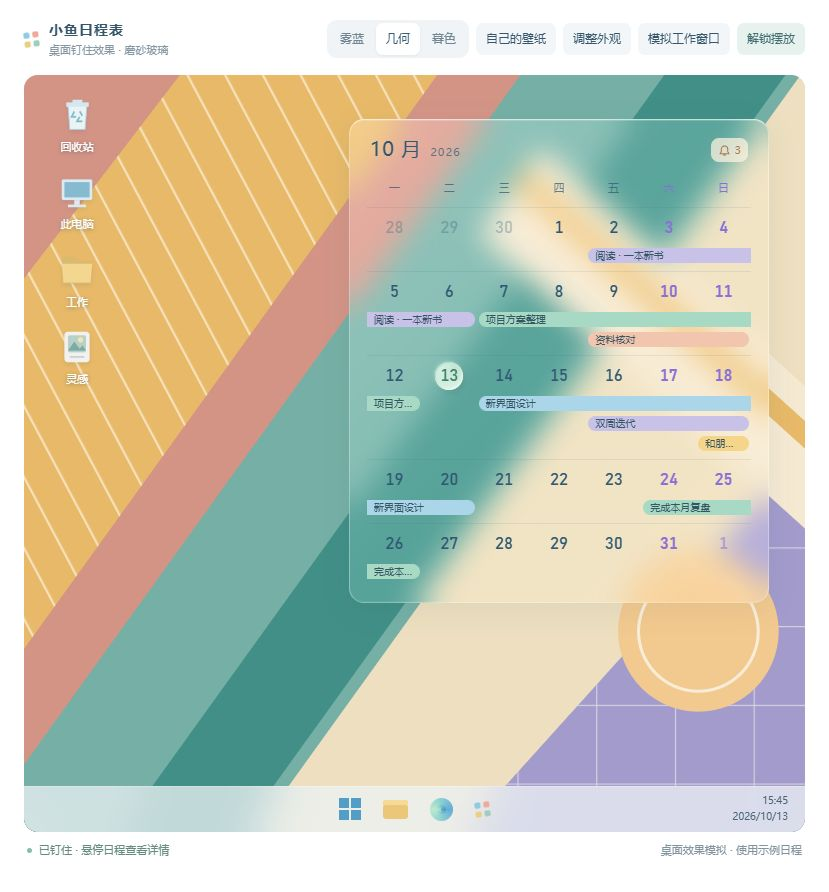
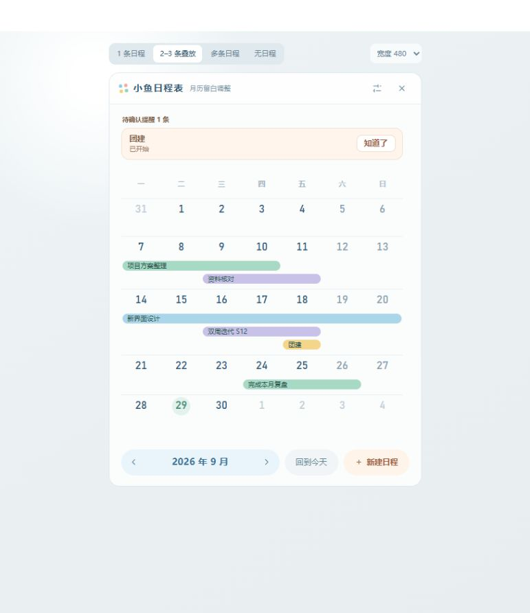

# 小鱼日程表 · 项目进度

更新日期：2026-10-21。

协作约定：默认只做本地修改和记录；只有星尘明确要求同步 GitHub 时才上传，不自动同步。独立 HTML 预览也只在明确要求时更新，软件修改不再自动重新生成预览。

测试授权与范围：此前两次可见短测都没有看到日历；参考 Rainlendar 改造后的自动短测只完成运行记录，Computer Use 的截图与输入通道未修好。随后星尘改为手动测试，已确认日历可见、图标在上方且鼠标经过不闪。自动测试和手动反馈分别保留，不把手动操作算成工具成功。主面板的检查使用隐藏窗口与内存示例；10 月 21 日没有启动或重启实际程序，没有操作系统鼠标或桌面。以后不再读写旧 `交流/` 目录。

## 当前停在哪里

**当前优先事项：继续按星尘的实际体验优化主面板。** 单击一天 / 拖选区间后新建，以及按钮新建，两种入口均已完成。月份切换、“回到今天”和“新建日程”现移到日历上方，位于标题下、提醒之前，避免月份行数改变时操作排上下跳动。新建 / 编辑弹窗采用紧凑布局，颜色和提醒按需展开，底部操作始终可见。主界面采用 14.52px 白色、灰蓝细描边的圆润指针；预览条的空标题文字为“预览”。最新操作排位置只修改实际软件，独立 HTML 尚保留之前布局。没有重启正在使用的程序。

**10 月 21 日已应用：更快收起与设置磨砂浮窗。** 设置在日历上方浮起，外侧空白、关闭按钮和 Esc 均可关闭，内部按“外观、提醒、通用”分类。默认外观不再是一长页；窗口仍按内容调整高度。自动收起等待从 500ms 改为约 100ms，动画立即起步、末尾放缓，途中鼠标返回可以反向展开。隐藏检查通过，实际手感待星尘重启小鱼后体验；本次按要求集中同步 GitHub。

桌面手动反馈已收到：星尘上传的截图显示日历正常出现，图标清晰位于日历上方，并明确反馈“这次挺成功的”“不闪了，不过整体还有细节想要优化”。这确认了当前的可见性、截图中的图标层级和鼠标经过不闪；“显示桌面”后是否保留尚未单独确认，磨砂尚未接入。按星尘要求先处理主面板，暂不继续修改桌面部分。

Computer Use 的独立排查结果保留：普通窗口截图超时，自动点击失败，重建 JavaScript 连接未恢复。尚未修好，不能把手动点击记成工具操作成功。详见下方“Computer Use 专项排查”。

**2026-10-20：新桌面显示方式已通过隐藏检查，并收到上述手动体验反馈；尚未完成所有场景验收，背景磨砂暂未接入。** 当前使用“隐藏网页排版 + 独立原生透明窗口显示”。原生窗口钉住时进入现有壁纸容器，不再把 Electron 窗口直接改成桌面子窗口，也不在鼠标轮询里反复调整层级。

前两次可见短测中，即使父子关系和 API 返回正常，星尘仍未看到日历。这两次仍记录为失败，不能用后来的成功覆盖。最新手动截图补上了“屏幕上确实看到”的证据；10 月 19 日原生磨砂有效但溢出边缘的结果属于旧显示方式，不能代表这一版已有磨砂。

悬停详情和提醒展开仍会带动真实窗口增高，整个主窗口没有固定高度。设计 HTML 仅保留为方案参考，软件功能仍由 `app/` 中的代码提供。

| 内容 | 当前状态 | 文件入口 |
| --- | --- | --- |
| 实际软件 | 已加入更快收起与磨砂设置浮窗，保留两种新建入口、紧凑弹窗和统一指针；桌面显示暂不改动 | `app/` |
| 桌面挂件效果模拟 | 保留已选定的薄荷绿柔光圆与轻磨砂方案，作为软件迁移的对照；10 月 14 日短测及本次整理未再修改设计 | [桌面钉住效果模拟.html](设计/桌面钉住效果模拟.html) |
| 最近一次浏览器预览 | 由软件页面生成，按需更新；当前未包含操作排上移 | [主界面预览.html](设计/主界面预览.html) |
| 日历布局方案 | 已采用；默认展示空白周、两三条叠放和单条日程，作为视觉参考 | [便当盒主界面提案.html](设计/便当盒主界面提案.html) |
| 需求与功能清单 | 保留作功能依据；当前实施状态以本文为准 | [需求_v1.3.md](需求_v1.3.md)、[功能目录树.md](功能目录树.md) |

## 今日修改：2026-10-21

- 月份切换、“回到今天”和“新建日程”移到日历上方，切换月份时按钮位置保持稳定。
- 鼠标移开后的收起等待缩短至约 100ms，优化缓动；途中返回可顺势展开。
- 设置改为磨砂浮窗，分“外观 / 提醒 / 通用”，点击外侧空白、关闭按钮或 Esc 退出；高度随内容调整。
- 日程条设置直接展开；磨砂改为 0–40 滑块，说明改成旁边的线条问号，悬停显示。桌面实际磨砂仍待接入。
- 删除“把日子安排好”，复选框与单选框统一为浅底色、柔和描边的样式。

收起、设置、日期选择及填写弹窗的隐藏 / 模拟检查已通过；未重启实际软件，手感待体验。独立 HTML 改为按需更新，目前未包含操作排上移。

本次按要求同步源码、测试脚本、文档和已有设计文件到 GitHub 私有仓库；本机日程、依赖和缓存不上传。

## 历史集中保存：2026-10-20

星尘明确要求“所有进度记录并上传 GitHub”。同步目标为 [小鱼日程表私有仓库](https://github.com/starash07/xiaoyu-calendar) 的 `main` 分支；整理前已核对仓库仍为私有，远端和本地提交均停在 `b63c2c2`。本次保存此后全部项目源码和资源修改，并以本文、根目录 README、`app/README.md`、需求与功能清单记录当前状态。

| 保存内容 | 当前结果 |
| --- | --- |
| 桌面显示改造 | 去掉静态壁纸副本；隐藏网页排版，由独立原生透明窗口显示并挂靠桌面。修正缩放、宿主变化、失败恢复与频繁重排的问题。旧磨砂尝试及失败原因保留在历史记录，新窗口尚未接入磨砂 |
| 桌面体验反馈 | 星尘手动确认日历可见、图标在上方、经过时不闪；显示桌面后的保留、多屏与重启恢复仍待验证 |
| 两种新建入口 | 单击 / 拖选后松开直接弹窗；底部新建按钮保留。包含反向、跨周、取消选择以及防止填写时自动收起 |
| 紧凑弹窗 | 默认表单约 390px 高，日期并排、备注两行；颜色和提醒按需展开，保存与取消保持可见。空标题预览文字为“预览” |
| 统一光标 | 保存原始 `mouse.svg` 和实际资源；主界面可点击处统一使用白色、灰蓝细描边的 14.52px 小指针，热点为 (3, 1) |
| 检查与预览工具 | 保存桌面隐藏检查、短测入口和主面板检查脚本；实际软件生成的 HTML 预览内嵌最新光标，可离线查看 |
| 文档 | 更新当前完成项、用户反馈、历史失败、剩余问题和运行方法，修正旧 README 与“下一步”中已过时的桌面状态 |

核对的既有结果：10 月 20 日两种新建入口的 14 项检查、紧凑弹窗的 8 项检查均通过；桌面 100% / 125% 缩放隐藏检查通过。这些是此前执行并保存在本机的记录，本次没有重跑可见测试，也没有把最后几次光标与文案微调算作重新做过完整交互测试。本次 20 份修改 / 新增脚本的语法检查、差异格式检查、依赖清单与锁文件解析均通过；已核对 SVG 资源、最新文案和生成预览一致。

上传范围沿用 `.gitignore`：项目源码、原始与派生光标、测试脚本、需求、功能清单、README、本文及设计预览；不上传依赖、缓存、本机日程和自测运行数据。旧 `交流/` 目录本次不读取、不修改。后续仍只在星尘明确要求时同步 GitHub。

## 主面板新建方式：2026-10-20

星尘明确要求两种入口：直接单击一天 / 拖选区间，松开鼠标后新建；保留下方已有的新建按钮。

- 从日历日期或空白处按下鼠标左键即可选择，不需要先点「选日期」。拖选时日期行显示浅色选区和天数，跨周分段显示，反向拖选自动整理起止日期。
- 松开鼠标后打开原有填写弹窗，自动填入所选日期。首尾补齐的上月 / 下月日期也可选择；拖出日历后松开使用最后经过的有效日期。
- 拖选中按 Esc、右键，或窗口失去焦点、鼠标捕获被中断时取消；随后松开不会误弹窗。拖选和填写弹窗之间持续阻止主窗口自动收起。
- 点击已有日程条仍查看详情。从日期 / 空白处开始的拖选可以经过日程条。窗口仍由顶部空白处拖动。
- 下方「新建日程」保留，直接填写：当前月默认今天，其他月份默认该月 1 日。Ctrl+N、托盘和空月份入口沿用此方式。
- 移除多余的「选日期」按钮及旧提示条。同步需求中的流程、快捷键、验收项和功能清单；实际软件生成的 `设计/主界面预览.html` 同步更新。

验证：`npm run selftest:calendar-selection` 的 14 项隐藏交互检查通过，覆盖单日、跨周、反向、补齐日期、移出后松开、5 种取消路径、已有日程点击、按钮默认日期，以及选区传入创建接口并显示新条。测试使用实际 W2 页面和预加载接口，创建接口写入内存样例；没有读写真实日程，没有打开可见窗口或控制系统鼠标。结果在 `app/.data-selftest/shots/w2-selection-result.json`。此处不代表已完成真实吸附窗口的手动体验验收。

这轮最初仅在本地修改，现纳入 10 月 20 日按要求集中保存的范围。当前运行的软件需重新启动后加载最新交互修改。

### 主界面光标

按星尘提供的根目录 `mouse.svg` 制作光标资源 `app/renderer/w2/date-cursor.svg`，保留原图的圆润轮廓，颜色从黑色改为纯白色后，白底上辨认较费劲；现保留白色主体，增加约 0.83px 的灰蓝色细描边（#7994a3），画布留出描边余量避免边缘截断，点击位置对齐箭头尖端。初版 22px 缩小 40% 后为 13.2px；按最新反馈再增大 10%，现为 14.52 × 14.52px，热点同步调整为 (3, 1)。日期悬停、日期空白区与拖选过程统一使用它；主面板原来显示小手的按钮、日程条、提醒卡片，以及新建 / 编辑弹窗和设置页中的相关控件，也统一换成这个小指针。拖选经过日程条或移出日历时保持同一形状，松开或取消后恢复各控件的光标规则。文字输入光标和按钮等待状态仍按原逻辑显示。使用系统光标直接移动，不另做延迟跟随的页面图层。实际软件预览同时内嵌该 SVG，保持单文件可用。

### 新建 / 编辑弹窗紧凑化

星尘反馈弹窗太满、太长，需要向下滚动。本轮把默认表单整理为约 390px 高：

- 标题、并排的开始 / 结束日期、两行备注直接可见。日程条预览并入弹窗标题行，未填写标题时显示“预览”，填写后显示实际标题。
- 颜色和提醒折叠为两个小入口，置顶开关放在同一排；一次只展开颜色或提醒其中一项。预设色、最近颜色、取色器、HEX 输入、统一 / 单独提醒及四项提醒仍可使用。收起不会清空已选资料，编辑旧日程时也会保留。
- 取消填写时强制撑到 640px 的做法；按表单完整内容计算所需高度，上限仍由屏幕剩余空间决定。保存、取消固定在底部；空间不足时只滚动中间填写区域，保存失败的提示也在底部。
- 设置页继续保留原有填写空间。弹窗与日历宽度测量延到下一帧更新，修复检查中发现的尺寸观察循环告警。

验证入口为 `npm run selftest:task-dialog`：8 项隐藏检查通过，默认表单在 480px / 380px 宽度和 420px 可用高度下没有滚动；320px 高的极短窗口保留中间滚动且底部按钮可见。已验证折叠后的完整保存、已有日程编辑回填、空标题校验与保存失败重试；查看了默认和展开提醒的页面截图。原有两种新建入口的 14 项检查也通过。测试均使用隐藏页面与内存样例，不控制系统鼠标，不读写真实日程。

## 参考 Rainlendar 后的桌面改造：2026-10-20

星尘要求“可以参考这个来做一下”，指 Rainlendar。以下记录该阶段的桌面改造；当时未安装 Rainlendar、未上传 GitHub，相关代码现纳入 10 月 20 日集中保存。后续主面板修改见上节。

核对的来源与边界：

- [Rainlendar 2.22.1 官方更新记录](https://github.com/rainlendar/Rainlendar-Resources/releases/tag/2.22.1) 明确提到借鉴 Rainmeter 修复 Windows 11 24H2 的 On Desktop 行为。这证明两者有参考关系，不能证明小鱼在本机 Windows 10 上可以直接照搬。
- [Rainmeter 桌面位置说明](https://docs.rainmeter.net/manual/settings/skin-sections/) 区分普通置底与 On Desktop，后者支持显示桌面后保留。它没有承诺在桌面图标下方，因此没有擅自放弃星尘的图标下层要求。
- [Rainmeter 的绘制代码](https://github.com/rainmeter/rainmeter/blob/master/Library/Skin.cpp) 使用独立分层窗口和 `UpdateLayeredWindow`；[桌面管理代码](https://github.com/rainmeter/rainmeter/blob/master/Library/System.cpp) 将桌面状态检测与窗口重排分开。参考的是这两个原则，未整段移植其源码。
- Rainlendar 的公开 Resources 仓库不是当前应用源码，不能称已经核实 Rainlendar 全部底层实现。官网下载页访问失败后，只将官方 Linux 发布包下载到忽略目录 `.cache/rainlendar-reference/` 查看资源清单，未运行或安装。

本轮实现：

1. 网页只负责日历与动画排版，Windows 原生窗口显示透明帧。解锁时可以交互和摆放，钉住时点击穿透。网页不再直接参与 Explorer 父子窗口切换。
2. 桌面宿主只接受可见且属于 Explorer 的窗口；旧隐藏 WorkerW 和其他进程同名窗口不参与。只移动小鱼自身，不重排图标、桌面宿主或 Wallpaper Engine。
3. 100ms 光标检查只处理悬停。桌面宿主变化、新的壁纸绘制窗口或低频健康检查发现实际关系变化时，才恢复自己的位置或顺序。关系没有变化就不调用挂靠与重排。
4. 修复解锁状态启动时没有正确定位、原生宿主销毁后重建、钉住失败却返回成功，以及设置保存失败时未恢复原状态的问题。
5. 增加窗口退出和鼠标移出的处理；原生画布分配或提交失败会记录并提示，不直接抛出未处理的主进程异常。圆角由图像透明度表示，不叠加旧的溢出磨砂。
6. 核对 125% 缩放时发现位图逻辑尺寸与 Win32 屏幕像素不同，以及尺寸往返换算的一像素差异；现按显示器尺寸转换帧，过时的大幅不同尺寸帧不会把窗口底边拉回旧高度。
7. 暂不对新窗口启用旧原生磨砂接口。设置值继续保留，设置页明确说明尚未接入；其他颜色、透明度、宽度、日期字号等继续生效。不使用静态壁纸图片冒充当前动态壁纸。

已执行的隐藏检查：

- 100% 与测试进程模拟的 125% 缩放通过；不修改系统缩放。125% 最初因帧尺寸判定和一像素舍入失败，修正后通过。
- 网页原始帧透明留白 alpha 为 0、左上角 alpha 为 0，顶部底板 alpha 为 51；125% 时原生显示缓冲为 545 × 525px，对应 436 × 420 的逻辑窗口。
- 100 次鼠标检查、10 次健康检查和一次无变化的桌面通知，没有重新挂靠、定位或启用材质。
- 详情高度 420 → 522 → 420，包含动画中间帧，顶边不动；展开没有触发桌面重挂靠。
- 在自有隐藏宿主中模拟新的壁纸子窗口，只恢复一次小鱼的绘制顺序；模拟父窗口关系丢失、宿主销毁、保存失败、宿主缺失和解锁后重启定位均通过。
- 原生帧提交没有失败。上述像素和结构检查不代表真实桌面已经可见，也不验证磨砂。

该阶段准备的可见短测为：先显示独立挂件 4 秒，再钉住 16 秒；观察“显示桌面”后是否保留、图标是否清晰处于上方、鼠标经过是否闪，最迟 25 秒自动退出。获准后的执行情况见下节；此后星尘已改为手动体验，当前不再等待这一步作为主面板工作的前提。

当前测试入口：`npm run selftest:desktop-headless`（隐藏）、`npm run selftest:desktop`（可见短测，需先确认方便）。记录分别在 `app/.data-selftest/shots/w1-host-result.json`、`w1-desktop-host-result.json`。`selftest:desktop-ui` 已适配新显示方式但本轮没有运行；主窗口日历布局、真实日程数据和 GitHub 未改动。

### 获准后的自动鼠标短测尝试

星尘回复“你自己用模拟鼠标操作吧”。已读取 Computer Use 技能及其操作规则，通过 `@oai/sky` 初始化并分别查询应用、窗口清单。清单只提供普通应用窗口，没有桌面或任务栏。随后启动一次独立数据短测，查询和复查均未返回“小鱼日程表 · 桌面”这个原生透明窗口，因此没有伪造窗口对象、猜测坐标或发送鼠标输入。

测试运行 20,576ms 后自动退出，记录 79 次采样。程序报告 `structuralPass: true`、钉住返回成功、1 次挂靠、7 帧原生提交、绘制错误为 0，期间没有重挂靠或层级修复。`desktopForegroundObserved: false`、`visualPass: null`。这些仅为运行记录，无法证明日历在真实桌面上可见，也不能证明图标层级或鼠标经过不闪。

本次没有点击“显示桌面”，没有收起其他工作窗口，没有截图验收。当前卡点是自动操作工具不提供桌面与透明挂件的目标窗口，不能把它记成鼠标测试完成。日志为 `.cache/desktop-native-short.stdout.log`、`.cache/desktop-native-short.stderr.log`；结构记录更新在 `app/.data-selftest/shots/w1-desktop-host-result.json`。真实数据未改动、未推送 GitHub。

## Computer Use 专项排查：2026-10-20

星尘要求先解决 Computer Use 无法操作的问题，随后提醒上一轮按钮是她手动点击的，并要求重新测试。此前的手动点击不计为自动操作成功；重新启动了计数为 0 的独立诊断窗口。星尘另确认当前是在电脑本机操作。

本轮实测：

- `@oai/sky` 可以导入，`list_windows` 正常返回普通应用；插件已启用。不是整个技能都无法连接。
- 独立 Electron 诊断窗口最初采用隐藏方式启动，第一次 `show()` 后 `isVisible()` 为 false；在诊断脚本中重新隐藏、显示后为 true，并被 Computer Use 返回。这个问题只在独立诊断脚本中修正，不能据此断言已经解决日历挂件不可见。
- 对正常返回的独立窗口读取无障碍文字成功，能看到“验证点击”“已点击 0 次”和输入框。
- 截图及激活后重新截图分别出现 `FrameArrived timed out: timed out waiting on channel`、`window capture timed out: timed out waiting on channel`。
- 在用户要求重测后，按刚读取的按钮索引调用 `sky.click`，返回 `coordinate input geometry is unavailable`。重新测试的记录始终是 `clicks: 0`，没有成功自动点击，也没有输入测试文字。
- 系统计算器也出现相同截图超时。重置 JavaScript 会话、重新导入、重新选择并激活计算器后仍然超时。
- 空白记事本使用“只截图、不读取文字”同样超时，排除了仅由 Electron 页面或同时读取文字引起的可能。后续文字读取曾返回 `foreground window did not report a process id`；最后刷新清单时已无这些测试窗口，不继续使用旧窗口对象。
- 本机系统为 Windows 10 19045，同时枚举到 RTX 3060 与 GameViewer 虚拟显示适配器。用户确认本机操作；没有证据证明虚拟显示适配器就是原因，因此未禁用设备、修改显示或安全设置。

判断：此前只知道桌面、任务栏和透明挂件没有进入可操作窗口清单，这不足以解释全部问题。本次确认普通窗口的截图通道也存在故障。当前只定位到“等待窗口画面超时”，尚未确定底层原因，不能声称鼠标功能已修复。

排查暂停前提出的下一步是重启 ChatGPT/Codex 应用，再验证独立普通窗口的截图和一次真实工具点击。仅重置 JavaScript 会话已经试过，无效。随后星尘决定先手动测试小鱼，因此这一排查建议暂不执行，也不作为手动测试的前提。自动桌面验收仍未完成。

依据：[Computer Use 官方说明](https://learn.chatgpt.com/docs/computer-use)；本机技能 `C:/Users/elwing/.codex/plugins/cache/openai-bundled/computer-use/26.1013.40934/skills/computer-use/SKILL.md` 及其引用的 `docs/guidance.md`、`docs/api.md`。本轮没有改动这些工具文件或权限设置。

本地诊断文件均在忽略目录：`.cache/computer-use-diagnostic.cjs`（独立窗口，最长 180 秒自动退出）、`computer-use-diagnostic-result.json`（用户要求重测后的结果）、`computer-use-diagnostic-manual-result.json`（前一轮，不能作为自动操作证据）。本轮没有改动日程功能、真实数据或同步 GitHub。

## 可见短测：2026-10-19（历史记录，未通过）

收到“现在可以简短测试”后运行 `selftest:desktop`。最初的 DWM 区域方案在透明度从 100% 调回 14% 后仍呈白色，条纹在关闭、轻磨砂、柔雾下的起伏都约 0.45，实际合成不正确；改变调用顺序也没有解决。已删除该 DWM 区域调用，关闭挂件系统厚边框，保留窗口形状裁切。

撤销该尝试后的最新实测：橙色／蓝色背景能透过挂件；不透明度两端分别为 alpha 13／255；条纹起伏为关闭 **80.02**、轻磨砂 **1.74**、柔雾 **1.26**，磨砂本身有效。但卡片外 8px 留白的条纹仍被模糊，触发“磨砂溢出到卡片外的透明留白”断言，整轮失败并自动关闭。不能用系统返回的圆角区域或接口成功替代这项画面检查。

本轮没有继续操作全局桌面：Computer Use 未返回可操作的任务栏窗口；没有使用猜测坐标或其他系统快捷键代替点击。图标下层定位仅有此前屏幕外结构检查证据，真实“显示桌面”仍未验证。真实日程数据未变，GitHub 未推送。

最新失败结果：`app/.data-selftest/shots/w1-smoke-result.json`；实际合成条纹截图：`w1-glass-stripes.png`。语法与差异格式检查另行通过，不代表这轮视觉测试通过。

## 后续修正：2026-10-19 尖角、图标层级与显示桌面

星尘的新截图确认两处问题：磨砂超出圆角卡片，左上角出现方形尖角；钉住的挂件仍在图标上方，把图标也模糊了，点击右下角“显示桌面”后消失，切到其他窗口才恢复。读取进程确认本机正在运行 Wallpaper Engine，因此不能重新使用系统登记的蓝色静态壁纸来冒充当前背景。

本轮代码修改：

- 撤销上一版的桌面 owner 关联。挂件不再与桌面宿主成组调整层级，直接安放在图标层正下方、壁纸层上方；先检查可分开的图标与壁纸层，无法识别时明确降级为普通置底窗口，不宣称成功钉住。
- 保留原生磨砂，原有 100ms 光标轮询同时核对层级；Windows 显示桌面或重排窗口后恢复到图标下方，无需等用户再点击工作窗口。只移动挂件自身，不移动桌面图标或其他应用窗口；补上 Aero Peek 排除设置。
- 曾尝试同时设置窗口形状和 DWM 磨砂区域；后续可见短测证明该做法会影响实际合成，现已撤销 DWM 区域调用。保留窗口圆角形状及透明留白，但 Win10 的实际磨砂仍溢出，未解决。
- 自测的意外错误改为记录在独立目录并退出；断开的日志输出不会再触发 Electron 错误框。此处理只用于 `--selftest`，不吞掉正式运行时错误。
- 桌面短测增加“必须在图标正下方”“打乱层级后恢复”“磨砂不能溢出到透明留白”的检查。

本轮已执行的检查：12 份修改／新增脚本通过语法检查，`git diff --check` 通过；自测日志异常检查通过。另建立完全位于屏幕范围外的独立 Electron 窗口，使用实际 Windows API 核对：owner 为 0，窗口位于图标层正下方，置底打乱后能恢复；圆角区域在初次设置、后续绘制和层级变化后均排除外侧点与角点、保留内部点，原生磨砂接口仍返回成功。该窗口已退出，结果保存在本机 `.cache/glass-boundary-check.json`。

以上是可见短测前的结构检查。后续可见短测已证明磨砂边界不合格，详见上方记录；图标遮挡、显示桌面／恢复工作窗口仍需实际验证。设计 HTML、真实日程数据和 GitHub 均未改动。

## 前序问题记录：2026-10-19 桌面玻璃背景不对

星尘提供的实际截图中，挂件呈现明显的蓝色底板，日期文字偏暗，与选定的轻透明磨砂效果不一致。截图带有“拖动摆放位置”和“钉住”按钮，属于解锁摆放状态。

检查旧实现确认：`app/main/w1.js` 读取系统登记的静态壁纸，`app/renderer/w1/w1.js` 将它铺在挂件的 `.bg` 层上。该图层没有透明度处理；设置中的 14% 仅作用于其上方的白色 `.tint` 层，并不让底下的壁纸图片透明。本机登记的是 Windows 自带的蓝色 `img0.jpg`，所以即使后方是其他内容，仍显示蓝色壁纸。星尘明确纠正：“自带的”是指软件带出来的背景，并非在说明真实桌面使用什么壁纸。此前把这句话当成系统壁纸确认，是理解错误。

这不能靠更换文字颜色或调低白色底色透明度解决。HTML 模拟是在同一网页内模糊背后的场景，当前软件则使用静态壁纸副本；两者的背景处理不同。此前短测只核对了图片加载及位置偏移，没有验证真实内容能否透过玻璃，也没有以此作为视觉验收条件，属于验证遗漏。

另外已确认当前系统是 Windows 10，Electron 提供的现成系统磨砂接口只支持 Windows 11 22H2 及以上，不能直接把该接口当成本机修复方案。[Electron 官方说明](https://www.electronjs.org/docs/latest/api/browser-window#winsetbackgroundmaterialmaterial-windows)

本次已完成的代码修改：

- 删除壁纸读取、图片底层、对齐偏移和定时刷新，改用 Windows 原生磨砂；不支持时使用真实透明底板并提示。
- 六项外观调节保留。系统接口不支持任意像素半径，磨砂控件改为“关闭／轻磨砂／柔雾”三档，旧数值按范围映射；已选配色、字号和高度规则保留。
- 原生玻璃跟随挂件圆角和动态高度裁切；主窗口日历布局不变。
- 短测发现原来的 WorkerW 子窗口不支持该磨砂接口。改为让挂件保持顶层窗口，通过 owner 挂靠桌面宿主并放在其前一层；普通工作窗口仍应位于挂件之上，钉住时点击穿透，解锁时恢复摆放与置顶。该整合代码尚未实测，不能宣称层级和切换已经通过。

本次实际测试结果（使用独立测试数据）：

- 色块从橙色换成蓝色时，挂件内部采样同步变化，证明背后的实际内容能透出。
- 0% 底板采样 alpha 为 13（保留少量表面高光），100% 为 255。条纹起伏从关闭磨砂时约 80 降到轻磨砂约 1.75、柔雾约 1.23，证明实际背景被柔化。
- 详情高度 **491 → 592 → 491px**，捕获到缓动中间帧；六项调节、保存后重新读取、恢复默认、提醒确认与完成同步通过。
- 随后“钉住后原生磨砂仍可用”的断言失败，整轮 `selftest:desktop` 退出码为 1。
- 独立探针确认：子窗口调用失败；保持顶层窗口并挂靠桌面 owner 时，接口返回成功。此探针结果不替代完整挂件的视觉与交互验证。
- 临时探针有一次直接启动，输出管道先结束，后续 `console.log` 导致 `EPIPE: broken pipe` 错误框。星尘反馈突然弹窗后，已确认该测试进程不再运行，并移除这份临时探针脚本；不涉及真实日程数据。此后停止显示测试窗口，待方便时再继续。

当前仍待验证：整合后的钉住／解锁切换、正常窗口遮挡、圆角边界、桌面显示与恢复。测试记录在 `app/.data-selftest/shots/w1-smoke-result.json`，独立场景截图在 `w1-real-glass.png`。本轮未启动实际数据实例，未修改用户日程，也未同步 GitHub。

## 沟通记录：2026-10-16

星尘要求把所有修改记录进沟通文档，并推送 GitHub。继续以本文作为统一的进度和沟通入口，不再阅读或修改旧交流本。本次整理涵盖上次远端保存之后的全部本地改动；没有再次启动软件或扩大测试范围。

| 修改范围 | 已完成内容 | 对应文件 |
| --- | --- | --- |
| 桌面外观定稿 | 保留轻磨砂玻璃、深色日程条文字、亮蓝紫色周末和薄荷绿柔光今天圆；记录未采用的试验，保留四份对比截图 | `设计/桌面钉住效果模拟.html`、`设计/桌面玻璃-今日…-2026-10-13.png` |
| 应用到桌面挂件 | 迁入选定外观、右上角提醒、连续日程条和下方悬停详情；窗口随动画增减高度，顶边保持原位 | `app/renderer/w1/`、`app/main/w1.js` |
| 外观自由调节 | 六项控件实时预览、保存、恢复默认；保留原有条目字号和高度；统一默认值与范围，兼容旧设置 | `app/renderer/shared/appearance.js`、`app/main/store.js`、`app/renderer/w2/settings.js`、`app/renderer/w2/index.html` |
| 交互与稳定性 | 修正壁纸对齐和配置读取；拖动、钉住、遮挡时正确收起详情；补上保存失败提示；防止旧保存回调覆盖正在调整的预览；修复解锁后置顶未恢复 | `app/main/w1.js`、`app/renderer/w1/w1.js`、`app/renderer/w2/settings.js` |
| 简短测试 | 新增桌面挂件单独测试入口；记录 10 月 14 日通过的结果及未覆盖项，保留原有全套测试入口 | `app/main/w1-smoke-selftest.js`、`app/main/main.js`、`app/package.json` |
| 项目说明 | 更新实际软件状态、预览用途、启动与短测说明、设计选择、测试结果和后续待办 | `README.md`、`app/README.md`、本文 |

目前交付的是可以继续实用体验的桌面挂件版本。多屏、长内容贴近屏幕底部、真实拖动全过程及重启恢复等仍列为待验证，不把基础短测当成全部验证完成。具体实施和测试记录见下文。

## 桌面挂件短测：2026-10-14（已通过）

按星尘“可以进行简短的测试”的授权，新增可单独运行的 `npm run selftest:desktop`。该入口使用 `--selftest` 的独立数据目录，带 45 秒超时保护，完成后自动关闭测试窗口。最后一次通过的实际检查用时约 6.9 秒，命令退出码为 0。

- 修改过的 5 份业务脚本语法检查通过。
- 实际窗口加载成功：默认宽 420px、日期 17px、亮蓝紫色周末、薄荷绿今天圆、深蓝灰日程条文字；当前静态壁纸成功加载。测试月份中的 3 条未完成日程全部显示，已完成条目隐藏。
- 悬停前、展开后、移开后的实际窗口高度为 **481 → 582 → 481px**。展开和收起均捕获到多个中间高度；窗口顶边和日历位置保持不变，实际窗口高度与页面内容一致。这里的高度是本次测试数据的结果，不是固定尺寸。
- 在实际设置页面逐一调节玻璃不透明度、宽度、日期字号、磨砂强度、玻璃底色和文字颜色：输入时桌面外观预览生效，调整完成后保存，重新从磁盘读取结果一致。日期字号变化不会改变日程条文字字号；恢复默认通过。
- 确认提醒后标志更新；完成日程后，该条目从桌面日历中隐藏。
- 改变测试窗口位置后，壁纸副本的偏移同步变化。没有更换用户壁纸或更改屏幕设置。
- 实际嵌入 WorkerW 成功；解锁后离开 WorkerW 并恢复置顶。短测发现旧的操作顺序会使解锁窗口丢失置顶状态，已把“恢复置顶”放到普通窗口重新定位之后，复测通过。
- 测试脚本也修正了“解锁后父窗口必须为 0”的错误判断，改为核对系统桌面父窗口和实际置顶状态。[微软 SetParent 文档](https://learn.microsoft.com/en-us/windows/win32/api/winuser/nf-winuser-setparent)说明传入空父窗口时会回到系统桌面父窗口。
- 旧版默认外观更新、自定义外观保留通过。已查看实际窗口的悬停截图；当前蓝色壁纸下默认深色文字偏暗，可通过现有文字颜色和玻璃不透明度调整，未因此擅自更改选定配色。

测试代码：`app/main/w1-smoke-selftest.js`。本机结果：`app/.data-selftest/shots/w1-smoke-result.json`；截图：`app/.data-selftest/shots/w1-smoke-hover.png`。测试结束后已确认测试 Electron 进程退出。

本次仅为短测：真实鼠标拖动全过程、贴近屏幕底部的长内容、多屏和混合缩放、动态壁纸、系统重启恢复未覆盖；设置持久化验证是保存后重新读取，不等同于系统重启实测。10 月 14 日当天没有同步 GitHub，相关源码和记录纳入 10 月 16 日集中保存。

## 桌面挂件应用：2026-10-13（当日只完成代码）

- 桌面页面已迁入轻透明玻璃底板、透光边缘、亮蓝紫色周末、深蓝灰日程条文字，以及选定的薄荷绿柔光浮雕“今天”圆。日期继续使用 28px 定位框，周细线下方留 6px；空白周最小 54px，并随宽度变化；日程条默认 15px 高、间距 5px。
- 继续读取实际日程和提醒。只显示当月日历中的未完成日程；新建、修改、完成、删除和提醒确认沿用原来的同步通路。跨天日程保持连续，按实际数量增加周行高度。
- 详情从日历下方缓动展开、收回；收回时保留内容直到动画结束。页面每帧报告内容高度，原生窗口顶边固定、底边随内容伸缩，不使用固定窗口高度。
- 提醒标志改为右上角的小铃铛与数量，悬停提示到主窗口查看。解锁后拖动上方提示条摆放，再点击“钉住”；钉住后沿用桌面嵌入和悬停通路。
- 主窗口设置页已提供六项自由调节：玻璃不透明度、挂件宽度、日期字号、磨砂强度、玻璃底色、文字颜色。调整时预览、松手或选完颜色后保存，关闭设置时清掉未保存预览；原有的甘特条字号和高度也保留。
- 默认外观统一放在 `app/renderer/shared/appearance.js`：白色底板 14%、14px 磨砂、420px 宽、17px 日期、文字 `#315873`。默认值和允许范围由挂件、设置页、存储共用，可以恢复默认。
- 加入旧设置兼容：旧版黑底、白字、28% 这一组未调整的默认配色更新为新默认；其他自定义配色、宽度和字号保留。旧版默认 12px 条高迁为 15px，缺少的日期字号补为 17px。兼容处理随下次程序启动生效，本轮没有直接改写 `app/.data/`。
- 背景仍沿用读取静态壁纸、对齐位置后模糊的方式。对齐改为读取背景层实际位置；补上居中、平铺的缩放换算、跨区背景范围和桌面底色，缓存壁纸配置，避免拖动时每帧启动读取注册表的进程。换壁纸或显示方式仍由定时检查更新。
- 补上鼠标静止时的遮挡判断：其他窗口盖住挂件后，关闭原来的悬停详情；从桌面嵌入恢复后的状态会重新同步。
- 拖动位置只从顶部提示条发起，拖动或切换钉住状态时收回悬停内容；位置或钉住状态保存失败时给出提示。宽度变化会重新核对鼠标所在条目，连续调节外观时保留日历节点，避免详情反复重建。
- 设置页正在调节时保留当前预览，旧的保存回调不能覆盖新一轮调整。补上日期、日程和提醒的无障碍说明，以及系统减少动画设置下的静态展示。

10 月 13 日按要求仅完成上述源码变更，没有运行测试。10 月 14 日获准后的短测结果见上方记录；动态壁纸、不同屏幕分别使用壁纸及混合缩放多屏不视为已经支持或验证。

主要文件：`app/renderer/w1/`、`app/main/w1.js`、`app/renderer/shared/appearance.js`、`app/main/store.js`、`app/renderer/w2/settings.js`。这轮应用没有改动主窗口月历布局和共享日程排版算法；当日没有同步 GitHub，相关改动纳入 10 月 16 日集中保存。

## 已经应用到软件

- 主窗口改为竖版圆角卡片。提醒在日历上方，月份切换、回到今天和新建入口在日历下方，日程详情位于最下方。
- 提醒使用堆叠卡片，可以点击展开、收起，用滚轮切换顶层卡片，逐条点击“知道了”。
- 保留新建、编辑、删除前确认、完成、置顶、月份浏览、拖选日期等已有功能。
- 日程条悬停、选中时使用较轻的颜色和位移反馈，去掉原来突兀的边框。
- 修复主窗口左上角等圆角的裁切：根页面透明，面板统一裁切背景和内容。
- 修复真实窗口的高度联动：悬停日程时向下展开详情，窗口底边随动画延伸；移开后缩回。点击日程后详情保持显示，点击空白处收起。
- 正常展开详情时，日历和窗口顶边保持原位。到达屏幕工作区底部时才限制窗口高度，让内容滚动；长备注保留完整文字。
- 提醒展开也会增加窗口高度。新建弹窗和设置页会留出操作空间；上、左、右贴边的收起与滑出仍保留。
- 2026-10-10 应用纯白主界面背景；周末表头和日期采用明亮蓝紫色 `#8a70d6`，非本月周末为浅一档的 `#b7acd7`。今天继续使用薄荷绿圆底。
- 应用 17px 日期字号、28px 日期行和今天圆底。空白周随宽度变化，最小 56px；有日程的周按条数自然增高。
- 日程条仍高 15px，条间距为 5px；增大提醒与日历之间的留白、日历上下留白和底部操作间距。滚动条出现时不会改变日历宽度。
- 上述 2026-10-10 布局参数只用于主窗口；桌面挂件后来单独采用桌面 HTML 的尺寸规则，见上方本轮应用记录。预览页面外部的密度切换工具没有放入软件。

软件当前外观，使用独立的 2026 年 9 月示例数据，截图于 2026-10-10：

## 桌面挂件 HTML 的方案调整历史

本节保留方案逐步调整的过程，“尚未应用”指对应当时的状态。2026-10-13 最后选定的方案已写入实际程序，当前状态以上方应用记录为准。

2026-10-10，星尘要求先用 HTML 模拟钉在桌面的效果，再慢慢调整。文件为 [桌面钉住效果模拟.html](设计/桌面钉住效果模拟.html)，可以直接双击打开，无需安装依赖。

2026-10-12 修复预览入口：原来的 `127.0.0.1:13936` 无法访问，是本地预览服务已停止，检查时该端口没有进程监听，HTML 文件仍在。已重新启动服务，并新增根目录的 [打开桌面效果预览.html](打开桌面效果预览.html)，双击即可直接打开本地文件，无需服务。临时网址不保证跨会话持续运行；之后离线查看可使用这个入口。这次入口修复没有修改桌面模拟的布局或实际程序。

同日，按星尘要求将桌面模拟改为透明磨砂玻璃：默认白色底板不透明度从 62% 降至 24%，背景模糊从 12px 增至 24px，并添加轻微的透光渐变、边缘高光和柔和阴影。模糊仅作用于卡片背后的壁纸，日期与日程条保持清晰；“调整外观”内可以设置玻璃不透明度、玻璃底色和 0–40px 磨砂强度。已在浏览器查看效果，检查默认样式和磨砂滑块即时生效。实际程序尚未应用这次材质调整。

2026-10-13，星尘反馈原背景下磨砂效果不明显。本次把默认预览背景换成带斜线、网格和交错色块的彩色几何壁纸，原“浅色”选项改为“几何”；“雾蓝”和“暮色”仍可切换。背景图形内嵌在 HTML 中，离线打开也能显示。已在浏览器查看玻璃内外的清晰度差异，并验证背景切换；玻璃参数仍为上一版的 24% 不透明度、24px 模糊。

同日，按星尘“磨砂弱一些、底色透明一些”的反馈，把默认模糊从 24px 降为 14px，白色底板不透明度从 24% 降为 14%，外观调节滑块同步更新。已在浏览器确认实际样式并查看效果，壁纸颜色和轮廓透出更多。本次仅调整 HTML 预览，尚未应用到实际桌面挂件。

随后按星尘要求，尝试将甘特条上的文字从深蓝灰改为纯白 `#ffffff`，保存截图后未被采用。

同日，按星尘反馈恢复甘特条的深蓝灰文字 `#345662`。每周日期与上方细线的留白从 3px 加至 6px；所有日期统一使用 28px 的数字定位框，微调数字的视觉位置，使今天的数字在圆底中居中，并与同一行其他日期对齐。已在浏览器核对五行间距均为 6px、日期数字齐平，并查看截图。当前仍为 HTML 试调，实际软件未迁移。

随后尝试将“今天”的薄荷绿实色圆改成透明玻璃圆：使用 7% 白色底、轻微透光渐变、3px 背景模糊和淡高光边缘。该方向未被采用，星尘希望保留原来的实色底，再覆盖磨砂玻璃。

之后恢复原薄荷绿实色底 `#e3f2ec` 与绿色数字 `#4e957f`，上方叠加柔雾、偏左上的柔和高光和右下方的淡绿阴影；悬停时高光轻微移动，使玻璃层更有层次。圆形仍为 28px，数字清晰且保持居中。已在浏览器查看默认效果，核对同一行日期仍齐平。此轮仅更新本地 HTML 和记录，没有同步 GitHub。

之后按星尘提供的柔白圆形按钮参考图，尝试“柔白浮雕圆”，但将参考图的白底和灰紫字一起照搬了。星尘明确纠正：今天标记继续使用绿色系，参考图只借鉴质感，要结合当前背景灵活应用。

之后保留参考图柔和凸起、边缘透光和轻柔投影的表现，底色改为薄荷绿 `#c5e5d8`，数字为绿色 `#427e68`；表面反光、亮边和阴影均使用绿色系，去掉蓝粉白底的配色。星尘觉得这一版还可以，并希望继续试“绿色渐变藏在毛玻璃下面”的感觉。

之后尝试将今天标记分成两层：下方是偏向左下的模糊绿色渐变，上方覆盖半透明毛玻璃圆片。星尘实看后认为圆圈太小，效果不好，要求恢复此前说“还可以”的绿色系柔光浮雕圆。

当前已恢复该版本：薄荷绿底 `#c5e5d8`、绿色数字 `#427e68`，配合同色系柔光、透光边缘和轻柔投影。保留 28px 尺寸及原有日期间距、居中位置。浏览器已刷新并确认恢复，当前以这一版继续；本次仅修改本地预览和记录。

- 放在完整的桌面场景中查看：壁纸、桌面图标、任务栏，以及可以遮住挂件的示例工作窗口。
- 第一版以半透明白色底板、蓝紫色周末和连续日程条为起点；顶部显示当月月份与角落提醒标志。
- 点击“解锁摆放”后拖动上方提示条，再点击“钉住”；钉住后保留悬停详情，不提供日程编辑入口。
- 日程详情在日历下方缓动展开，卡片自然增高，顶边保持原位；移开后收回。内容多时模拟桌面也会增高，避免裁掉下方日程。
- 预览工具放在桌面场景外：三种壁纸、选择自己的壁纸，以及底板颜色、不透明度、模糊、宽度、日期字号、文字和周末颜色。
- 可以切换少量、适中、密集、无日程的示例。日期随打开时的月份生成，示例日程只存在页面内存中。
- 这份 HTML 只模拟外观和交互，不是真实的 Windows 桌面嵌入，也不读取、保存实际日程。最终选定的效果已单独迁入 `app/renderer/w1/`，并通过 10 月 14 日的实际软件基础短测。

当前轻磨砂玻璃效果（几何背景，14% 不透明度、14px 模糊、深色条目文字、今天已恢复星尘选定的薄荷绿柔光浮雕圆）：

10 月 10 日的第一版截图保留在 `设计/桌面钉住效果-2026-10-10.png`；10 月 12 日的雾蓝背景磨砂效果保留在 `设计/桌面磨砂玻璃效果-2026-10-12.png`；10 月 13 日调整前的几何背景效果保留在 `设计/桌面磨砂玻璃-几何背景-2026-10-13.png`；轻磨砂搭配深色文字的效果保留在 `设计/桌面玻璃-轻磨砂-2026-10-13.png`，用于对比。

未采用的白色条目文字试验截图保留在 `设计/桌面玻璃-白色条目文字-2026-10-13.png`。

日期间距与居中调整后的实色圆版本保留在 `设计/桌面玻璃-日期居中-2026-10-13.png`，用于与玻璃圆对比。

未采用的透明玻璃圆试验保留在 `设计/桌面玻璃-今日玻璃圆-2026-10-13.png`。

薄荷实底叠磨砂玻璃的版本保留在 `设计/桌面玻璃-今日薄荷磨砂圆-2026-10-13.png`，用于与新参考图方案对比。

未采用的柔白浮雕圆试验保留在 `设计/桌面玻璃-今日柔白浮雕圆-2026-10-13.png`，后续参考材质时继续保持今天标记的绿色系。

未采用的渐变毛玻璃圆试验保留在 `设计/桌面玻璃-今日渐变毛玻璃圆-2026-10-13.png`，仅作对比，不作为当前方案。

### 应用到软件时保留的自由调节（已应用，基础短测通过）

2026-10-13，星尘明确要求：截图中以下六项自由调节功能，需要随桌面挂件方案一起应用到正式软件，让用户在软件内自行调整：

- 玻璃不透明度。
- 挂件宽度。
- 日期字号。
- 磨砂强度。
- 玻璃底色。
- 文字颜色。

这些属于正式软件要保留的功能，现已接入主窗口的“设置 → 桌面挂件外观”。截图中的 17% 等数值只是当时的预览状态，不据此改动默认值；默认不透明度继续为 14%。

## 已采用的 HTML 方案

星尘认为软件里的日历太紧凑；第一版加大留白后，又反馈日期数字稍大、空白周偏高，需要加入两个以上日程的例子一起看。

2026-09-29 确定的布局调整，已于 2026-10-10 迁移：

- 日期字号由试验版的 18px 收到 17px，软件现已一致。
- 空白周保留适量基础高度，并随窗口宽度变化；480px 宽度的预览中约为 58px，窄版下限为 56px。
- 有日程的周按实际条数增加高度。当前示例中，1 条、2 条、3 条分别约为 61px、81px、101px。
- 默认在同一张月历里摆放空白周、2 条叠放、3 条叠放、1 条日程、空白周，方便直接比较。
- 页面外部提供“1 条日程 / 2–3 条叠放 / 多条日程 / 无日程”切换，以及 480px、400px 宽度切换。这些是预览工具，不属于软件界面。
- 继续保留日程详情在底部展开的效果。日历有基础比例，日程多时仍可增高，整个窗口不设固定高度。

这份 HTML 用于讨论布局，并非完整的软件功能入口；其中部分操作按钮仍是示意。不要用它替换实际软件页面，也不要用生成脚本覆盖它。

2026-10-10 试过珊瑚红、湖蓝、青绿和蓝紫后，星尘选择先保留明亮蓝紫色周末与纯白背景。当前配色以设计 HTML 和软件代码为准；下面的早期截图只记录留白方案。

## 后续继续遵守的交互约定

- 整体方向是干净、清爽、稍带活泼的扁平化小卡片；减少一层套一层的外壳。
- 主界面顶部只放提醒；月份和新建等操作放在日历下面。
- 悬停显示日程详情，点选后保留详情并显示操作。详情展开要有缓动，同时带动真实窗口底边。
- 弹窗存在时阻止主窗口自动收起。主动关闭或收起时，可以放弃未保存的输入，不做草稿保留。
- 删除前确认，不做删除撤销。
- 已完成日程在桌面挂件中隐藏，在主窗口中置底并灰显。
- 跨天日程保持连续，不按每天的上限把同一条日程任意截断；当前先按内容增高，暂不设硬性条数上限。
- 阿砚后续不参与开发。`交流/` 保留历史文件，不再阅读、续写或作为交接入口；后续进度统一更新本文。

## 已做的验证

### 桌面挂件迁移：2026-10-13～14

10 月 13 日仅完成代码，10 月 14 日获准后进行了桌面挂件短测并修复解锁置顶问题，结果见本文上方“桌面挂件短测”。以下保留此前的主窗口和 HTML 验证结果，不表示本轮重新跑过这些检查。

### 桌面模拟 HTML：2026-10-10

- 脚本语法检查通过，本地预览服务返回正常页面。
- 在浏览器中检查了解锁、拖动、重新钉住、工作窗口遮挡、壁纸切换，以及不透明度和宽度调节。
- 悬停后详情正确展开，卡片顶边不动；离开后收回。修正了拖到较低位置后展开详情可能推动卡片上移的问题。
- 密集模式显示 14 条不同日程、22 段跨周横条，未超出所在周；无日程模式没有残留横条和详情占位。浏览器未记录脚本错误或警告。
- 截图已保存到 `设计/桌面钉住效果-2026-10-10.png`。

### 本轮实际软件：2026-10-10

`npm run selftest` 已通过，使用独立的 `app/.data-selftest/`；没有向实际日程中添加测试数据。

- 480px 窗口下，五周实测高度依次为 **58 / 81 / 101 / 61 / 58px**，与 HTML 方案一致；400px 下为 **56 / 81 / 101 / 61 / 56px**；640px 下空白周增至 80px。
- 4 周、5 周、6 周月份，以及 380/400/480/640px 宽度通过检查。30 条重叠日程完整排列，窗口到屏幕底部时内容滚动，底部操作仍可见。
- 检查了实际渲染的纯白背景、亮蓝紫色周末和 17px 日期；已查看 480px 与 400px 的真实窗口截图。
- 本轮测试数据下，悬停前后真实高度为 **667 → 773 → 667px**；展开和收起均有中间帧，日历与窗口顶边保持原位。提醒展开后为 770px，收起恢复 667px。
- 圆角外透明、长备注滚动、三侧贴边、弹窗填写空间、新建保存、空标题校验、设置页和桌面挂件嵌入均通过原有检查。
- 共享日历新增可选的条间距和文字内边距；主窗口使用新参数。另行比对旧版渲染结果，桌面默认参数在 12/15/22px 条高下输出一致。

布局检查代码：`app/main/w2-calendar-selftest.js`、`app/main/w2-layout-selftest.js`。软件交互预览 `设计/主界面预览.html` 已重新生成。

### 实际软件：2026-09-28

运行 `npm run selftest`，使用独立的 `app/.data-selftest/`，结果通过。测试代码保存在 `app/main/selftest.js` 和 `app/main/w2-layout-selftest.js`。

- 示例数据下，悬停前后真实窗口高度为 **501 → 607 → 501px**，展开和收起都记录到中间帧；窗口顶边和日历位置不变。这是该组数据的实测值，不是固定尺寸。
- 四个圆角外的像素透明。
- 点选保留详情、点击空白收起、快速切换日程、提醒展开与收起通过检查。
- 靠近屏幕底部时限制在工作区内，底部操作可见，长备注可以滚动。
- 上、左、右贴边后，收起仍只露出 3px，滑出位置正确。
- 原有自测还检查了新建保存、空标题校验、设置页、桌面挂件嵌入及解锁。

原始截图和结果在本机 `app/.data-selftest/shots/`，不随运行缓存一起上传。本文记录结果，并单独保存了上方的示例截图。

### HTML 方案：2026-09-29

叠放方案已在浏览器查看。默认 480px 宽度下，五周实测高度依次为 **58 / 81 / 101 / 61 / 58px**；日期字号为 17px，日程条没有超出所在周的边界。这组尺寸现已应用到软件。

## 下一步

1. 先体验 10 月 21 日的收起手感与设置磨砂浮窗，再按反馈微调。当前两种新建方式、紧凑弹窗和 14.52px 白色细描边指针保留。
2. 桌面当前的可见、图标层级和不闪已得到手动确认，暂不继续改动。之后单独验证右下角“显示桌面”后的保留，再研究适用于当前原生显示窗口的磨砂效果；旧 DWM 区域方案已被可见短测否定，不能凭接口成功认定解决。
3. 后续测试补上真实鼠标拖动、多日程与长备注、靠近屏幕底部的展开边界、多屏和混合缩放、重启恢复。Computer Use 故障排查暂停，由星尘先手动测试。
4. 保持窗口随内容调整高度、跨天横条连续，不通过固定窗口高度或隐藏部分日程来处理密集内容。
5. 后续修改继续记录在本文，不读写旧交流本。10 月 21 日修改本次按要求集中同步，之后仍只在明确要求时上传。

## 历史 GitHub 保存范围：2026-10-16

本次根据星尘的明确要求集中同步，目标为 `starash07/xiaoyu-calendar` 私有仓库的 `main` 分支。同步前核对远端停在 `0b5a295`；本地尚未推送的 `24f4388`（早期透明今天圆试验）及之后的全部修改一并纳入历史，最终文件采用已确认的薄荷绿柔光圆。

本次新增保存内容：桌面挂件外观与交互迁移、六项自由调节、旧设置兼容、壁纸与摆放处理、解锁置顶修复、桌面短测入口和结果说明、最新桌面 HTML、四份今天圆的对比截图，以及两份 README 和本文。采用与未采用的方案均已明确标注；后续待验证项继续保留。

保存全部项目源码、启动脚本、依赖清单和锁文件、需求文档、功能清单、README、本文、设计 HTML、项目截图，以及已经存在的其他项目文件和修改。

沿用 `.gitignore`，不上传 `app/node_modules/`、`.cache/`、`app/.data/`、`app/.data-selftest/`：它们分别是可重新安装的依赖、缓存、本机日程数据和自测运行数据。所需的示例截图已单独放进 `设计/`。
